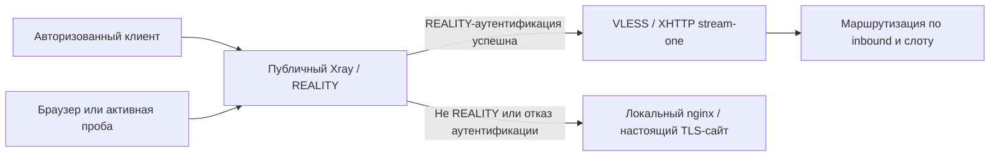

# Противодействие активному пробингу: исследование и ТЗ

- **Дата исследования:** 2026-11-12.
- **Статус:** техническое задание к реализации, не отчёт о развёртывании.
- **Область:** семейный VPN на 5–20 пользователей; публичные входы RU-relay и
  резервного exit, сегмент relay→exit, поверхность управления.
- **Связанные решения:** D-001, D-002, D-003 и D-011 в
  [реестре решений](DECISIONS.md); этапы 3, 6 и 8
  [архитектурного плана](ARCHITECTURE_PLAN.md).

**Цель — уменьшить вероятность распознавания и последующей блокировки узла,
а не гарантировать, что его IP никогда не попадёт под ограничения ТСПУ.**
Выбранное средство: REALITY self-steal с собственным доменом и локальным nginx
на публичных входах; точный source allowlist на межсерверном входе exit.
VLESS + XHTTP + REALITY сохраняются.

Исходный `ARCHITECTURE_PLAN.md` не изменяется. Этот документ дополняет требования,
не выдаёт выбор средства за готовую реализацию и не разрешает изменения
production, DNS, firewall или сертификатов. Отмена изменения документации —
отдельный PR с отменой squash-коммита, без переписывания `master`.

## 1. Результат задачи и границы

Исполнитель реализации должен предоставить работающий контур защиты, изменения
контрактов и шаблонов, проверки из раздела 8, эксплуатационную инструкцию и
проверяемый откат. Пустая роль, сайт без проверенного fallback или один успешный
`xray -test` не являются выполнением задачи.

В репозитории уже есть локальный рендер
[exit/transit-профилей](PROFILES.md), [роль base](BASE_ROLE.md) и библиотека
[TCP/TLS/HTTP-проб](PROBES.md). Это не развёрнутый VPN. Рендер relay, локальный
cover-сайт, источник-ограниченный transit ACL и полноценная
REALITY/XHTTP-проба должны быть реализованы и интегрированы, а не считаться
существующими по наличию плана. Библиотека обычных TLS-проб не проверяет REALITY.

Не входят в эту задачу:

- замена обязательного стека на другой протокол;
- автоматическая смена SNI, fingerprint, порта, транспорта, XMUX или IP;
- новый третий hop, покупка адресов, включение WARP/CDN;
- сканирование чужих серверов или поиск рабочих адресов из разрешительных списков;
- получение credentials цензора, «ответные» атаки и блокирование сетей по
  предположительной принадлежности Роскомнадзору;
- утверждение, что обычный сайт делает VPN неотличимым при любых измерениях.

## 2. Модель угроз и качество доказательств

### Различать механизмы

| Механизм | Что наблюдает или делает противник | Что даёт выбранная защита |
| --- | --- | --- |
| Активный пробинг | Отдельно подключается к IP:port; варьирует TLS, SNI, HTTP, некорректные запросы и повторяет записанный ClientHello. | Неавторизованный посетитель публичного входа получает поведение настоящего локального HTTPS-сайта, а не интерфейс прокси. На закрытом transit-порту соединение не допускается. |
| Пассивная классификация | Изучает ClientHello, размеры и интервалы пакетов, длительность и число соединений пользователя. | Self-steal устраняет часть несогласованности домена и адреса, но не скрывает IP и не доказывает устойчивость к классификатору. |
| Ограничение потока | Пропускает начало соединения, затем отбрасывает пакеты по объёму, числу пакетов или состоянию соединений. | Корректный fallback этого не исправляет; нужна отдельная диагностика пути. |
| Блокировка IP, подсети или ASN | Запрещает адрес независимо от протокола и ответа сайта. | Защиты нет. Восстановление доступности — отдельная операция после классификации причины. |
| Разрешительный список назначений | Пропускает только разрешённые IP/домены. | Собственный домен или российское размещение relay сами по себе не дают допуска. |
| Получение клиентской конфигурации | Противник становится авторизованным клиентом через утечку или распространение ключа. | Маскировка ответа не помогает; нужны приватная выдача и отзыв credentials. |

Открытый адрес назначения виден сети даже при обращении по домену. Отсутствие
AAAA в публичном DNS не скрывает IPv6 межсерверного соединения от наблюдателя
на его пути. Source ACL не защищает от пассивного наблюдения этого пути.

### Что подтверждено источниками

- **Измерения:** Xue et al., IMC 2022, показывают in-path, stateful-фильтрацию
  по SNI, IP и QUIC [S3]. Активные пробы исследователей в этой работе нельзя
  выдавать за доказательство активного пробинга со стороны цензора.
- **Сообщения о сканировании:** RKS Global, обзор событий 2024 года, раздел
  «Active Probing», с. 16–18, описывает сканирование TCP/443 с адреса AS61280
  ГРЧЦ, в том числе пустых серверов [S4]. Это существенное свидетельство
  сканирования; принадлежность ASN не доказывает причинную цепочку
  «конкретный ТСПУ увидел REALITY → отправил пробу → заблокировал IP».
  Связь сканирования с массовым сбоем в самом отчёте обозначена как вероятная.
- **Наблюдения пользователей:** net4people #490 описывает остановку потока
  приблизительно после 15–20 КБ; позднее — порог порядка 25 пакетов и
  разрешительные списки [S6]. Это не универсальная константа и не доказательство
  отдельного зондирующего соединения. Несколько HTTP-запросов внутри одного
  TCP-соединения не обязательно обходят такой предел.
- **Другой класс ограничений:** #546 описывает проблемы TLS-соединений на
  домашних провайдерах, включая случаи, когда сайт на endpoint открывается,
  а туннель не работает; позднее автор сообщает о недостаточности mux/XHTTP
  для части пользователей [S7]. Нельзя сводить этот симптом к активному пробингу.
- **Современная картина:** отчёт critical infrastructure lab, сентябрь 2026,
  разделы 1.3, 2.2, 3.1 и 4.3, отделяет IP-блокировки, протокольную/поведенческую
  классификацию и allowlist-режим; предупреждает о неоднозначности симптомов [S5].

**Вывод исследования:** проектировать защиту от активных проб необходимо, но
публичных данных недостаточно для утверждения, что все российские блокировки
REALITY вызваны именно ими. Подтверждённого единого алгоритма ТСПУ, универсального
«безопасного» SNI, fingerprint или гарантированного срока жизни IP не найдено.

## 3. Реальные российские практики: успехи и неудачи

«Сообщение эксплуатации» ниже означает публичное наблюдение автора, а не
независимое воспроизведение в этом проекте. «Инструкция» подтверждает наличие
практики, но не её результативность. Даты конкретных комментариев проверены
отдельно; дата открытия обсуждения не подменяет дату позднего сообщения.

| Дата и источник | Контекст и конфигурация | Наблюдаемый результат | Ограничение доказательства |
| --- | --- | --- | --- |
| 2026-06-11, xstyl3s, Xray #4035 [S13] | Эксплуатация REALITY для пользователей российских LTE-сетей; домашний интернет продолжал работать. | По сообщению автора, `chrome` → `firefox`/`qq` восстановило соединение при том же IP, SNI и порте. | Операторы не названы; нет парных capture. Аргумент в пользу проверки fingerprint, не доказательство защиты от пробинга. Два похожих сообщения автора не считаются двумя независимыми случаями. |
| 2025-11-24, alxnklmn, net4people #490 [S6a] | Дальний Восток; смена `network` на HTTPUpgrade, также упомянуты XHTTP и gRPC. | Автор сообщает о восстановлении работы. | Нет точного XHTTP mode, версии, XMUX и длительности. Не подтверждает весь наш профиль и не отменяет обязательный REALITY. |
| 2025-11-14 / обновление 2025-11-22, #546 [S7] | MTS/MGTS Москва и JustLan частично затронуты; менее определённые сообщения о других сетях. Пробовались собственные сертификаты и self-steal. | Изначально помогали некоторые изменения порта/числа соединений; затем mux/XHTTP помогали не всем. | Автор указывает ограничения удалённого тестирования. Контрпример обещанию «self-steal или mux решает любой блок». |
| 2026-11-07, mureevms, Habr [S9] | VLESS + REALITY, self-steal на своём домене, XHTTP; несколько зарубежных провайдеров и ASN. | Автор описывает четыре заблокированных сервера за шесть недель, а после разделения входа/выхода — почти неделю без разрывов. | Операторы доступа не названы; нет доказательства причинной связи с пробингом или сообщениями приложений. Короткий успех после нескольких изменений не доказывает эффективность одного средства. |
| 2026-05-12 и 2026-05-13, tiredvpn-measurements [S8] | Публичный журнал для Ростелекома (провод) и МегаФона (LTE), узлы A и N. | Таблицы отмечают успех стратегии `REALITY Protocol` на обоих узлах 12 мая; 13 мая — отказ на N в обеих сетях при сохранении успеха на A. | Самопубликуемый журнал; полная методика и точный профиль не представлены. Формат не различает RST, silent drop и timeout. Отметки таблицы — не независимая верификация протокола или причины. |
| F3 Cloud, обновление 2026-10-21; OBLAKO, недатированная инструкция [S10], [S11] | Собственный DNS, сертификат, Xray на публичном порту и локальный nginx как REALITY target; описана интеграция с панелями. | Документирована практика self-steal; F3 прямо предупреждает, что такие серверы также попадали под блокировки подсетей. | Инструкции хостеров, не измеренные сравнения. Нет выборки пользователей, операторов и срока доступности. |
| DigneZzZ/remnawave-scripts, README на дату исследования [S12] | Русскоязычный эксплуатационный инструмент: Caddy/nginx за REALITY, внутренний TCP/Unix socket, согласованный PROXY protocol. | Есть описание установки, продления сертификатов и восстановления после ошибок. | Нет подтверждённой выборки российских провайдеров. Тезис «nginx тише Caddy» не подкреплён количественным российским сравнением. Скрипт не устанавливался в рамках исследования. |

Обсуждение REALITY fingerprinting #438 относится к Ирану [S14]. Оно полезно
для составления отрицательных тестов, но не включается в российские успехи.
Для NaiveProxy, Trojan и ShadowTLS в собранных источниках не установлено
достаточно подробного российского испытания, подтверждающего превосходство
над выбранным профилем.

Не найден публичный кейс, одновременно подтверждающий 5–20 частных пользователей,
`stream-one`, отсутствие Vision, неизменный XMUX, клиентский IPv4 и второй hop
IPv6 с IPv4 fallback. Это условия будущей приёмки, не результаты исследования.

## 4. Сравнение вариантов

Сравнение качественное: контролируемого российского A/B-измерения вероятности
блокировки для всех вариантов не найдено. Достоинства — свойства конструкции
и эксплуатационные компромиссы, а не выдуманный процент эффективности.

| Вариант | Достоинства | Недостатки и остаточные риски | Решение для проекта |
| --- | --- | --- | --- |
| REALITY self-steal + свой nginx | Согласованы публичный DNS, SNI, сертификат и сайт; нет зависимости от чужого target; сохраняется требуемый стек [S1], [S10]. | Домен, контент и ACME нужно обслуживать; IP/ASN и поведение туннеля видны; российские отказы документированы [S7], [S9]. | **Основное средство для публичных входов.** nginx выбран как обычный обслуживаемый TLS/H2-сервер, не как доказанно «невидимый» стек. |
| REALITY с внешним target в той же ASN | Не требуется собственный сертификат; неавторизованный трафик пересылается реальному сайту [S1], [S2]. | Чужой DNS/сертификат/доступность не контролируются; дополнительный сетевой путь; возможна несогласованность адреса и имени, злоупотребление fallback. Одна ASN не гарантирует правдоподобие или отсутствие блока. | Не основной режим. Возврат к чужому target не является автоматическим аварийным fallback. |
| Настоящий TLS на nginx + XHTTP за reverse proxy | Публичный TLS и HTTP обслуживает обычный веб-сервер; можно маршрутизировать приложение по HTTP [S18]. | Это замена REALITY, а не настройка его fallback. Нужна проверка H2, full-duplex, buffering и таймаутов; IP-блок и flow-классификация остаются. | Альтернативный профиль только отдельным решением владельца; обязательный стек не заменять. |
| NaiveProxy | Chromium network stack, HTTP/2 CONNECT, application fronting и padding предусмотрены проектом [S15]. | Новая серверная часть/клиенты и обновления Chromium; собственный домен; нет доказанного российского выигрыша в наших условиях. | Исследовательская альтернатива, вне реализации этого ТЗ. |
| Trojan | TLS с настоящим сертификатом и имитацией HTTPS; зрелая концепция [S16]. | Другой протокол; качество ответа неавторизованным клиентам зависит от реализации; TLS/traffic fingerprint и IP-блок остаются. | Не замена обязательного VLESS + XHTTP + REALITY. |
| ShadowTLS v3 + шифрующий прокси | Настоящее рукопожатие с выбранным TLS-сервером [S17]. | Дополнительный слой на обеих сторонах; сам не предоставляет шифрование/формат запросов прокси; зависимости target и ограничения клиентов. | Вне обязательного стека; российское превосходство не установлено. |
| Source ACL | Непрошеный клиент не достигает private transit или управления; простая политика для фиксированных адресов relay. | Не подходит как основной барьер для мобильных пользователей с меняющимися IP/CGNAT; не скрывает трафик от ТСПУ. | **Обязательно для relay→exit и управления**, но не для общего клиентского TCP-порта. |
| SPA / port knocking | SPA, например fwknop, авторизует открытие firewall до соединения, имеет защиту от replay [S19]. | Дополнительный клиент и bootstrap; NAT/смена сети; UDP может не проходить. Простая последовательность knock слабее аутентифицированной SPA. fwknop для nftables требует отдельной интеграции. | Не вводить ради этой задачи; ACL фиксированного второго hop проще. |
| Разделение ingress/egress | Сайты не видят IP основного RU-входа при штатном double-hop; уменьшает один канал раскрытия адреса [S9]. | Сам вход по-прежнему виден провайдеру клиента. Прямой exit-профиль раскрывает зарубежный вход, если его адрес совпадает с egress; второй адрес/третий hop — затраты и другой контракт. | Использовать существующий double-hop. Не удалять резерв `exit direct` и не добавлять новый hop молча. |
| Мониторинг и ротация IP | Помогают распознать отказ и организовать восстановление. | Не предотвращают пробинг; необоснованная ротация может не помочь и создаёт простой. | Диагностика обязательна; ротация остаётся отдельной операцией плана. |

## 5. Выбранная конструкция

Для каждого публичного REALITY-входа применяется одна схема:

Публичный вход RU-relay и резервный прямой вход exit получают свои домены и
cover-сайты. Для приватного transit-входа exit обычная публичная маскировка
не заменяет ACL. На том же exit он может использовать локальный cover backend,
но доступ к нему через transit разрешён только relay.

Не ставить TLS-терминирующий nginx перед обязательным REALITY: это меняет
внешний протокол. Здесь nginx — **target за Xray**, а не reverse proxy туннеля.
Отдельный HTTPS-сайт на другом публичном порту не заменяет fallback на самом
клиентском порту.

Основной путь остаётся клиент IPv4 → RU-relay → exit IPv6, с возвратом второго
hop на IPv4 того же exit. При отказе обоих межсерверных путей пользовательский
трафик не выпускается напрямую с relay. `exit direct` остаётся отдельным,
явно выбираемым клиентским профилем, не скрытым аварийным маршрутом relay.

## 6. Обязательные требования реализации

### AP-01. Идентичность публичного сайта

1. `reality_sni` задаётся отдельно для каждого узла и принадлежит оператору.
   Публичная A-запись соответствует его клиентскому IPv4; SAN сертификата
   содержит это имя. Публичный AAAA для exit не добавлять при клиентском `v4`.
2. Для межсерверного IPv6 не требовать публикации AAAA: иначе нарушается
   существующая политика адресации. Проверка сертификата/REALITY остаётся по
   имени, ACL — по адресу источника. Это осознанное отличие private transit
   от публичного сайта, а не доказательство сокрытия IPv6.
3. DNS для REALITY — прямой, без HTTP/CDN-проксирования. Панель, node API,
   метрики и страница подписки не публикуются в cover-сайте и не попадают в
   его HTML, ссылки, заголовки или ошибки. Не использовать чужой бренд.
4. Сайт содержит осмысленный операторский статический контент и локальные
   ресурсы, без рабочих данных семьи, трекеров и единой VPN-заглушки.
   Не устанавливать непроверенный one-click script из исследовательских ссылок.
5. nginx обслуживает HTTP/1.1 и H2, TLS 1.2 и 1.3. Его TLS backend находится
   только на `127.0.0.1:<cover_tls_port>` в том же network namespace, что Xray.
   RemnaNode с bridge networking не может использовать host loopback:
   предусмотреть проверенный host networking, а не публичный обходной порт.
6. HTTP/3 не рекламируется (`Alt-Svc`/HTTPS DNS record), пока соответствующего
   UDP-сервиса нет. Эта задача его не добавляет. Не выдавать отсутствие QUIC
   за доказательство невидимости: обычные HTTPS-сайты тоже бывают TCP-only.
7. Без SNI, с неизвестным SNI, неправильным Host или неизвестным путём сервер
   ведёт себя как выбранный обычный nginx virtual host. Допустимы его обычный
   сертификат, TLS alert, 404/405; нельзя искусственно отвечать 200 на любую
   пробу. Точное поведение фиксируется сравнением с локальным origin.
8. Не предоставлять произвольный CONNECT/forward proxy, динамический upstream
   по Host, доступ к внутренним адресам или панели через cover backend.

### AP-02. REALITY/XHTTP и credentials

1. На клиентских и межсерверных профилях: `network: xhttp`, `security: reality`,
   `xhttpSettings.mode: stream-one`; `flow` отсутствует. Сохранить параметры
   padding и XMUX исходного профиля; не добавлять `mux.cool`. Документировать
   фактически действующие defaults закреплённой версии [S18], не считать
   отсутствие `xmux` гарантией отсутствия мультиплексирования.
2. `reality_target` вычисляется как локальный TLS backend. Рендер сохраняет
   используемое в существующих профилях поле `dest`; `dest` и `target` —
   поддерживаемые aliases [S1], но в одном объекте допустимо только одно.
   `serverNames` — точный список собственных имён, без wildcard и пустого SNI.
3. `xver: 0`, `show: false`. Нельзя отправлять PROXY protocol обычному TLS
   listener: он сломает fallback. Для будущего отдельного режима с `xver: 1/2`
   потребуются согласованный private PROXY listener и отдельная приёмка; этот
   режим не нужен для выбранной конструкции.
4. `limitFallbackUpload` и `limitFallbackDownload` отключены/не выводятся.
   XTLS прямо предупреждает: ограничение fallback само становится fingerprint
   [S1], [S2]. Не подменять защиту фиксированным обрывом после N байт. Проблемы
   нагрузки сайта решать как обычную эксплуатационную задачу, без автоматического
   ban за ошибку REALITY-аутентификации.
5. Новые `shortIds` — случайные непустые 8 байт, записанные 16 hex-символами,
   без повторов; отдельные UUID служебных пользователей transit и пользователей
   direct. Не принимать пустой shortId «для совместимости». Существующие ключи
   не ротировать автоматически при смене cover-сайта.
6. Ссылки VLESS, `pbk`/REALITY `password`, shortIds и UUID — приватный материал
   доступа. Название «public key» не разрешает его публичную выдачу: XTLS
   отдельно поясняет клиентское назначение `password` [S1]. Серверные ключи —
   по [политике секретов](SECRETS.md); без вывода в diff, логи, CI или PR.
7. Новое значение `reality_max_time_diff_ms` — `300000` мс. Это инженерный
   стартовый бюджет на рассинхронизацию часов, а не найденное универсальное
   средство против ТСПУ. Включить в каждый соответствующий REALITY inbound.
   При вводе в эксплуатацию проверить часы серверов и выбранных клиентов;
   не отключать проверку времени автоматически при ошибке.
8. Временное окно не считать replay cache. Повтор записанного ClientHello
   не должен давать прокси-доступ без завершения TLS и VLESS-аутентификации;
   различия ответа на свежий replay внутри окна измерить и описать как
   остаточный риск, а не обещать абсолютную неотличимость.
9. Закрепить версии Xray, RemnaNode, nginx и используемых клиентских cores;
   проверить связку, включая H2. Текущая опорная версия рендера Xray — v26.11.9
   [PROFILES.md](PROFILES.md). Не переносить примеры Vision/raw TCP из гайдов
   в наш XHTTP-профиль и не обновлять runtime на `latest`.

### AP-03. Firewall и второй hop

1. Доработать существующую роль `base` и таблицу `inet vpn_base`, а не вводить
   вторую конкурирующую политику/UFW. Публичный клиентский TCP-порт разрешён
   обычным посетителям; backend nginx снаружи недоступен.
2. Для `transit_port` на exit разрешены только реальные исходящие адреса relay:
   IPv4 `/32` и IPv6 `/128`. Их соответствие проверяется по адресам сокетов
   на стенде; при NAT используется явно заявленный egress relay. Пустой ACL
   и `/0` отклоняются до изменения firewall.
3. Предусмотреть source-restricted правило в контракте `base`; текущий
   `base_firewall_vpn_ports` открывает порт всем и не выражает эту политику.
   Один и тот же порт нельзя одновременно объявлять публичным и source-restricted.
4. Панель, node API и exporter не доступны публичной пробе; доступ управления
   только по существующей приватной/SSH-политике. Отказ SSH не «чинить» открытием
   порта всему интернету. Не менять посторонние таблицы и Docker forwarding.
5. Сохранить необходимые ICMP/ICMPv6, ND/RA и PMTU-правила роли. Включение ACL
   не должно ломать IPv6 или незаметно переводить всё на IPv4.
6. Не блокировать весь RU-трафик, подсети мобильных операторов или неизвестные
   HTTPS-клиенты как «проберов». Список известных сканеров не является барьером
   безопасности и быстро устаревает.

### AP-04. Сертификаты, зависимость origin и отказ

1. Использовать обычный ACME-клиент Certbot с HTTP-01 через существующий nginx
   на TCP/80; публичное открытие 80 — отдельная заявленная часть rollout.
   Challenge обслуживается только из выделенного webroot; остальной HTTP
   перенаправляется на фиксированный собственный hostname, не на произвольный Host.
2. Синтаксис nginx выбирается под закреплённую и проверенную версию; не
   копировать без проверки конфликтующие советы гайдов о директиве `http2`.
   Ключ сертификата хранится только на узле с ограниченными правами, не в Git.
3. Использовать штатное продление и deploy hook с `nginx -t` перед reload.
   На стенде проверить первичный выпуск/установку сертификата, продление и
   отказ обновления. Уведомлять при оставшемся сроке менее 7 суток.
4. Перед публикацией профиля проверять: DNS, SAN/цепочку/срок сертификата,
   локальный TLS/H2 backend, сайт через сам публичный REALITY-порт,
   `nginx -t`, `xray -test` и авторизованную e2e-пробу.
5. Ошибка origin, сертификата или e2e-пробы запрещает активацию нового bundle.
   У работающего входа такой отказ считается инцидентом: REALITY зависит от
   target, нельзя обещать сохранение авторизованных соединений без проверки.
   Не переключать target на чужой сайт и не открывать дополнительный порт
   автоматически. Сохранить предыдущую проверенную конфигурацию для отката.

### AP-05. Диагностика без «магического детектора ТСПУ»

1. Собирать отдельно здоровье локального origin, обычный HTTPS через публичный
   вход, авторизованный REALITY/XHTTP и relay→exit для каждой семьи адресов.
   Для обычных проверок использовать существующий пакет `probe`; для H2 и
   REALITY нужен реальный совместимый клиент, а не успех TCP/сертификата.
2. В приватном отчёте: время, точка/оператор и тип доступа, физический интерфейс
   и маршрут, версия bundle/client core, семейство, SNI/fingerprint, этап отказа,
   объём передачи и адреса сокетов. TUN-путь и DC-relay не подменяют тест
   домашнего/мобильного клиента. Секреты и пользовательское содержимое исключить.
3. Рост обычных/fallback-подключений — аномалия, а не доказанное сканирование
   ТСПУ. При `xver: 0` nginx видит loopback, не исходный IP посетителя: не строить
   по такому логу фиктивную атрибуцию. При необходимости отдельного расследования
   разрешить ограниченный capture метаданных только на собственном стенде.
4. Сравнивать TLS/HTTP и полный туннель на одном IP:port, затем независимую
   внешнюю точку, DNS/origin и локальное состояние. При расхождении — парные
   capture клиента/сервера с согласия оператора, а не немедленная смена IP.
5. Классификация: `origin_failure`, `transport_failure`,
   `path_interference_suspected`, `ip_reachability_failure`, `unknown`.
   Ошибка одной пробы или источник из определённой ASN не дают статуса
   «активный пробинг подтверждён». Подтверждение требует отдельной сессии
   зондирования и доказательств связи с событием; неопределённость сохраняется.
6. Периодические проверки — ограниченные, не чаще одного обычного HTTPS-запроса
   на вход за 5 минут с каждой заранее согласованной точки. Отказ после
   активации проверять сразу; три последовательных плановых отказа дают алерт.
   Частоту e2e-проб и пилота назначает оператор, не внешние публичные сервисы.
7. Алерт содержит причину, точку, время и версию, без полного конфига/ссылки
   доступа. Автоматического blacklist scanner-IP, подбора SNI/fingerprint,
   включения mux или вызова ротации IP из этого контура нет.

## 7. Контракты и состав работ

Ниже **проектируемые изменения**, не существующие команды или переменные.
Существующие имена inventory сохраняются; второй независимый источник SNI
не вводится.

| Вход | Требование |
| --- | --- |
| `reality_sni` | Существующее имя per-host; одновременно имя REALITY и собственного cover-сайта. |
| `cover_tls_port` | Новый integer, default `9443`, 1–65535; не совпадает с SSH, 80 и любым Xray listener узла. |
| `reality_target` | Существующее поле; для выбранного режима равно `127.0.0.1:<cover_tls_port>`. Конфликт с явно заданным другим target — ошибка, не тихое переопределение. |
| `cover_site_source` | Новый обязательный путь к операторскому статическому контенту; не пустой фиктивный сайт. Публичные тесты используют только синтетические данные. |
| `cover_acme_email` | Новый операторский контакт ACME, задаётся локально; реальные контакты в example inventory не публикуются. |
| `reality_max_time_diff_ms` | Новое положительное integer-значение, default `300000`; отображается в `maxTimeDiff`. |
| `base_firewall_source_ports` | Новый список `{proto, port, source_cidrs}` в роли base; для transit — TCP и точные источники relay `/32` и `/128`. Пустые источники, широкие transit-сети и пересечение с публичными портами отклоняются. |

Проверка домена, сертификата и network namespace не сводится к YAML-валидации:
статический контракт проверяется до записи, фактические условия — preflight
и runtime. Все секретные операции выполняются без diff и вывода значений.

| Порядок | Изменяемый компонент | Обязательный результат |
| --- | --- | --- |
| 1 | Inventory/валидаторы и defaults ролей | Новые поля, приоритет per-host, отсутствие конфликтов портов/target, source ACL; обезличенный example. Без подключения к серверам при статической проверке. |
| 2 | Новая Ansible-роль `cover_site` | nginx, операторский контент, private TLS backend, HTTP-01 и продление, preflight/reload/rollback. Не устанавливает Xray и не меняет чужие сайты. |
| 3 | Существующая роль `profiles`, рендер relay и выдача профилей | Согласованный target/SNI/time window во всех relay/direct/transit inbound, служебных outbound и клиентских профилях. Старые чужие SNI/target не остаются скрытым путём. Конфиги остаются Git-управляемыми; API панели не считается пишущим, пока такой путь не реализован и проверен. |
| 4 | Существующая роль `base` | Транзакционный source ACL второго hop, без нарушения SSH/IPv6/PMTU и без публичного backend. |
| 5 | Пробы и эксплуатационная интеграция | Обычный HTTPS отделён от REALITY/XHTTP; приватные результаты/алерты, инструкция расследования, версии, проверяемый откат. Новые команды указываются в документации только после реализации. |

Зафиксировать одну версию bundle для серверных конфигов, доменов, firewall
и подписок. Мигрировать каждого caller SNI/target: relay→exit outbound,
прямые/relay клиентские профили и все соответствующие Hosts панели. Если
панель или клиент не поддерживает обязательный профиль, это блокер активации,
а не повод незаметно выдать Vision/raw TCP или убрать REALITY.

## 8. Приёмочные проверки

Все пункты ниже — **требования к реализации**, не выполненные проверки этого
документа. Лабораторные проверки используют реальные Xray/nginx/клиенты,
сгенерированные credentials и локальный test CA. Реальный публичный ACME,
российские сети и внешние изменения — только в отдельно разрешённом пилоте.

| ID | Сценарий | Наблюдаемое условие приёмки |
| --- | --- | --- |
| AC-01 | Неверные порты, внешний target, несовпадающий SNI/сертификат, пустой transit ACL, публичное/source-restricted пересечение, неправильный namespace. | Отказ до активации; предыдущая рабочая версия не изменена. Секретные значения не попадают в вывод. |
| AC-02 | Обычный браузер и TLS-клиент на реальном публичном Xray-порту; TLS 1.2/1.3, H1/H2, GET/HEAD, неизвестный URL/Host/SNI, отсутствие SNI. | Для обычного имени валидная цепочка и ожидаемый контент; для остальных вариантов поведение соответствует baseline nginx origin. Нет интерфейса VPN/панели. Сравниваются смысл ответа, ALPN и TLS-параметры, не случайные байты TLS-сеанса. |
| AC-03 | Неполный/некорректный и фрагментированный ClientHello, неверные REALITY key/shortId; отдельно правильный REALITY с неверным VLESS UUID. | Нет произвольного прокси-доступа. Отказ REALITY обрабатывается target; отказ последующей VLESS-аутентификации не обязан отдавать сайт, но не раскрывает управление и не даёт туннель. |
| AC-04 | Replay собственного тестового ClientHello внутри/вне окна; допустимый и превышающий `maxTimeDiff` clock skew. | Replay без необходимых ключей/завершения TLS не даёт VPN. Просроченный запрос не авторизуется. Ответ/тайминг свежего replay задокументирован; timestamp window не выдан за полную anti-replay-защиту. |
| AC-05 | Внешняя проба backend, node API, панели и exporter по v4/v6; положительный административный вход. | Backend/управление недоступны неподходящему источнику; разрешённый SSH/приватный доступ сохраняется. Проверяется фактический путь пакетов, включая Docker. |
| AC-06 | Полная передача relay→exit с разрешённых IPv4/IPv6; такой же запрос с посторонних адресов. | Оба разрешённых семейства работают, посторонний источник не достигает transit. Публичный direct-порт остаётся отдельным от transit. |
| AC-07 | Отказ IPv6 второго hop, затем отказ обоих семейств; восстановление IPv6; отдельно явный `exit direct`. | Fallback только на IPv4 того же exit. При двух отказах — fail-closed, без egress с relay. Путь доказан счётчиками inbound/outbound и адресами соединений, не одним внешним IP. Direct работает только как выбранный профиль. |
| AC-08 | 20 тестовых пользователей одновременно, по четыре прикладных потока; двусторонняя передача 1 МиБ на пользователя, отдельно 20 МиБ в одном туннеле, idle/reconnect. | Данные целы, нет утечки direct и искусственного предела fallback после 16–20 КБ. Все пользователи обслуживаются; записаны latency/throughput/нагрузка. Результат теста сайта не подменяет туннель. |
| AC-09 | Продление/замена сертификата, reload, reboot, отказ ACME и остановка origin. | Cover и авторизованный путь проверены после восстановления; плохой кандидат не заменяет рабочий. Ошибка origin диагностируется, не «лечится» внешним target/публичным портом. Сигнал о сроке сертификата проверен. |
| AC-10 | Смоделированные origin failure, недоступный IP и обрыв после начала потока. | Соответствующие наблюдения и алерт, при недостатке данных — `unknown`; нет автоматического обвинения ТСПУ, ban клиента или ротации IP. |
| AC-11 | Повторное применение и rollback bundle. | Повтор идемпотентен; откат восстанавливает сайт, профиль, ACL, подписку и доступ управления. Отзыв credentials не отменяется случайно восстановлением старого bundle. |
| AC-12 | Согласованный пилот не менее 7 суток: минимум одна домашняя и одна мобильная российская сеть, существующие клиентские приложения; отдельно DC-relay. | Отчёт по каждой точке/версии: успешные и неуспешные сессии, пределы измерения, A/B при смене SNI/fingerprint, отсутствие утечки ключей. Неудачная доступность не скрывается; blanket IP/ASN/allowlist-ограничение не считается доказательством поломки fallback и не превращается в обещание обхода. |

AC-08 — лабораторная нагрузка для проверки семейного масштаба, не установленный
«безопасный» профиль трафика перед ТСПУ. Не воспроизводить высокую частоту
рукопожатий или агрессивные сканеры на рабочем IP ради статистики.

Приёмка защиты от пробинга требует AC-01…AC-11; готовность к эксплуатации
в заявленных пользовательских сетях дополнительно требует AC-12 с
удовлетворительным авторизованным путём. Если сеть целиком запрещает выбранные
назначения, зафиксировать блокер и получить отдельное решение о восстановлении
доступности, не сокращая заявленную совместимость молча.

## 9. Ввод, откат и остаточные риски

1. Сначала одноразовый стенд и полный bundle, затем отдельное разрешение
   владельца на конкретные узлы/DNS/сертификаты/firewall и пилот. Нужны собственный
   домен, доступ ACME, совместимые клиентские cores и разрешённые точки РФ.
   Если prerequisites отсутствуют, внедрение заблокировано, не имитируется.
2. До внешних изменений сохранить предыдущие конфиги/ACL/подписки и рабочий
   административный путь. Новые DNS/сертификаты/backend готовить до переключения
   REALITY. Обрабатывать узлы по одному; отказ останавливает дальнейшую активацию.
3. Смена SNI — согласованное окно обслуживания с обновлением всех профилей,
   не бессрочный compatibility shim со старым чужим SNI. UUID/ключи без необходимости
   не менять. Проверить обновление подписки фактическими клиентами.
4. При неудачной активации восстановить прежний согласованный bundle, выполнить
   проверки публичного сайта, авторизованного пути и SSH; DNS восстановить
   вместе с версией и учитывать кэш. Если прежний IP уже заблокирован, откат
   конфигурации не считается восстановлением доступности.
5. Не откатывать отдельный отзыв скомпрометированного ключа вместе с конфигом;
   применять актуальное состояние пользователей. Не удалять старые сертификаты,
   адреса и доступ управления до успешной проверки новой версии.

Остаются риски:

- IP, домен и ASN можно заблокировать без пробинга; сертификат/CT и DNS могут
  связывать публичные домены инфраструктуры.
- Self-steal не исключает fingerprint REALITY, клиентского TLS, TLS-in-TLS,
  packet timing или корреляцию соединений.
- Сайты видят адрес exit; в резервном direct-профиле он может совпадать с
  публичным входом. Защита входа/выхода этого профиля требует отдельного
  решения, а не скрытого изменения D-001.
- `[INFERENCE]` Малая приватная группа и отсутствие публичной раздачи конфигов
  уменьшают некоторые каналы раскрытия, но не доказано, насколько это снижает
  вероятность блокировки.
- Нейтральный домен, nginx, порт 443 и `firefox` — не универсальные признаки
  допустимого трафика. Совместимость подтверждается конкретным пилотом;
  отсутствие блокировки за 7 суток не обещает её отсутствия позже.

## 10. Источники

Источники проверены на дату исследования. Динамические README/обсуждения —
снимок доступного публичного состояния, не неизменяемый стандарт. Для реализации
нужен собственный manifest закреплённых версий; детали актуальных upstream
документов сверяются с выбранным runtime. Исследование выполнено через Exa,
затем ключевые утверждения проверены чтением первичных документов и сообщений.
Команды и установщики из источников не запускались.

- **[S1]**
  Официальный контракт REALITY: forwarding неавторизованного трафика, aliases
  target/dest, shortIds/password, maxTimeDiff и предупреждение о fallback rate limit.
- **[S2]**
  Официальная конструкция и требования target TLS 1.3/H2. Утверждения о
  неотличимости — позиция проекта, не независимый российский результат.
- **[S3]**
  Xue et al., «TSPU: Russia’s Decentralized Censorship System», ACM IMC 2022;
  peer-reviewed измерения, DOI 10.1145/3517745.3561461.
- **[S4]**
  RKS Global, «The Darkest Times of Runet: A Review of Internet Censorship
  in Russia in 2024», с. 16–18; сообщения о сканировании и ограничения атрибуции.
- **[S5]**
  Dmitry Kuznetsov, critical infrastructure lab, сентябрь 2026;
  архитектура, виды ограничений и последствия для разработчиков.
- **[S6]**
  Наблюдения российского ограничения потока с 2025-06-27 и последующие уточнения.
- **[S6a]**
  alxnklmn, 2025-11-24: сообщение эксплуатации на Дальнем Востоке.
- **[S7]**
  Наблюдения домашних сетей с 2025-11-14; успехи и последующие ограничения решений.
- **[S8]**
  Самопубликуемый журнал. Сверены
  [2026-05-12](https://github.com/tiredvpn/tiredvpn-measurements/blob/main/reports/2026-05-12/report.md)
  и [2026-05-13](https://github.com/tiredvpn/tiredvpn-measurements/blob/main/reports/2026-05-13/report.md);
  точная конфигурация/атрибуция причин не подтверждены.
- **[S9]**
  mureevms, «Методичка по построению VPN, осень 2026», 2026-11-07;
  first-person отказы self-steal/XHTTP и короткое наблюдение после разделения адресов.
- **[S10]**
  Инструкция хостера, обновление 2026-10-21; self-steal и явное отсутствие гарантии.
- **[S11]**
  Инструкция хостера; наличие практики, не независимое измерение эффективности.
- **[S12]**
  Эксплуатационный self-steal инструмент; источник схем и рисков интеграции.
- **[S13]**
  xstyl3s, 2026-06-11: production REALITY для пользователей российских LTE-сетей.
- **[S14]**
  REALITY Server TLS Fingerprinting; иранский контекст, не российское подтверждение.
- **[S15]**
  Конструкция NaiveProxy: Chromium, application fronting, HTTP/2 и padding.
- **[S16]**
  Конструкция Trojan; не российское сравнительное испытание.
- **[S17]**
  Конструкция ShadowTLS и необходимость отдельного шифрующего прокси.
- **[S18]**
  RPRX, «XHTTP: Beyond REALITY»: stream-one, H2, reverse proxy и XMUX.
- **[S19]**
  SPA, replay-защита и отличие от последовательного port knocking.

[S1]: https://github.com/XTLS/Xray-docs-next/blob/main/docs/en/config/transports/reality.md
[S2]: https://github.com/XTLS/REALITY/blob/main/README.en.md
[S3]: https://censoredplanet.org/papers/tspu-imc22.pdf
[S4]: https://files.rks.global/censorship_review_en.pdf
[S5]: https://www.criticalinfralab.net/wp-content/uploads/2026/10/TSPU-and-You_WEB_2026-09.pdf
[S6]: https://github.com/net4people/bbs/issues/490
[S6a]: https://github.com/net4people/bbs/issues/490#issuecomment-3570408190
[S7]: https://github.com/net4people/bbs/issues/546
[S8]: https://github.com/tiredvpn/tiredvpn-measurements
[S9]: https://habr.com/ru/articles/1103460/
[S10]: https://docs.f3cloud.com/en/vpn-guide/reality-self-steal
[S11]: https://oblako.sh/wiki/ru/rukovodstva/blokirovki-reality-self-steal
[S12]: https://github.com/DigneZzZ/remnawave-scripts/blob/main/README-selfsteal.md
[S13]: https://github.com/XTLS/Xray-core/discussions/4035#discussioncomment-17268766
[S14]: https://github.com/net4people/bbs/issues/438
[S15]: https://github.com/klzgrad/naiveproxy
[S16]: https://github.com/trojan-gfw/trojan
[S17]: https://github.com/ihciah/shadow-tls
[S18]: https://github.com/XTLS/Xray-core/discussions/4113
[S19]: https://github.com/mrash/fwknop
