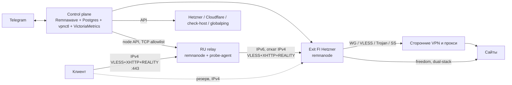

# Архитектура double-hop VPN: план

Это план, ничего не разворачивалось. Проверено по документации: требования Remnawave (панель ≥2 ГБ RAM, узел ≥1 ГБ, Docker), Config Profile как полный Xray JSON, сниппеты для `outbounds`/`routing`, Squads, вебхуки, смена Primary IP в Hetzner только на выключенном сервере. Остальное помечено `[INFERENCE]` и проверяется в отмеченных задачах. Дата: 2026-11-11.

## Зафиксированные решения

| Вопрос | Решение |
|---|---|
| Топология | RU-relay как основной вход и прямой вход на exit как резерв в той же подписке |
| Апстримы за exit | Подписки VLESS/Trojan/SS и WireGuard-конфиги |
| Выбор пути | Отдельный профиль в подписке, маршрутизация на сервере по inbound |
| Стек | Remnawave (панель + node-агенты) и свой `vpnctl` на Go (бот + воркер) |
| Control plane | Один набор ролей, режим `cp_placement: exit \| dedicated` |
| Смена IP | Только exit, через Hetzner Cloud API |
| IPv6 | Клиент→relay по IPv4; relay→exit по IPv6 с откатом на IPv4; exit→сайты dual-stack |
| Мониторинг | node_exporter + VictoriaMetrics single, алерты и графики через бота |
| Пробы | С RU-relay и через внешние сервисы |
| Секреты | SOPS + age в git |
| Бюджет | 1500 ₽/мес |

## Топология

## Ключевые механизмы

**Профили и выбор выхода.**
- В подписке профили вида `RU→FI`, `RU→FI→Mullvad NL`, `FI direct`.
- На exit — фиксированные слоты `egress-0…egress-N` (0 = прямой выход, N ≤ 5). Слот — это служебный пользователь транзитного inbound и правило `user → outboundTag`.
- Апстримы меняются только в `outbounds`, поэтому inbound'ы и клиентские подписки при обновлении не трогаются.
- Слот со сторонним апстримом fail-closed: если апстрим мёртв, трафик идёт в blackhole, а не через IP exit.

**Разведение слотов на relay.** REALITY на 443 — один inbound, а пользователь выбирает слот профилем. План: nginx `stream` с `ssl_preread` на 443 разводит по SNI на несколько локальных REALITY-inbound'ов. `[INFERENCE]` — проверяется в задаче 3.4; запасной вариант — отдельные порты. Каждый SNI тестируется отдельно: в вашей сети уже была SNI-фильтрация (CDN6).

(Возможный вариант вместо termination на relay: L4-транзит на HAProxy — relay пересылает TLS целиком, не видит plaintext и не хранит VPN-ключи, но не может применять per-user политики; в текущий план не входит.)

**IPv6.**
- На relay два outbound'а на exit, `exit-v6` и `exit-v4`, плюс balancer с `burstObservatory`.
- Переменные на узел: `s2s_family: v6_prefer | v4_only | v6_only`, `client_family: v4 | dual`, `egress_family: v4_prefer | v6_prefer | v4_only`.
- У exit не публикуется AAAA для клиентского имени. IPv6-адрес exit знает только relay.
- Primary IPv6 в Hetzner — отдельный ресурс, поэтому путь relay→exit переживает смену IPv4.

**Смена IP exit.** Последовательность: создать новый Primary IPv4 в hel1 → poweroff → снять старый → назначить новый → poweron → обновить DNS в Cloudflare → обновить адрес узла и хоста в Remnawave → проба с relay и извне → удалить старый IP через N часов (он тарифицируется, пока существует). Простой 1–3 минуты. Каждый шаг сохраняется в состоянии, операция возобновляема.

**Автообновление апстримов.** Источник → парсер (base64-ссылки или WG-конфиг) → нормализованный кандидат → проба через временный Xray на exit → выбор по фильтру слота (страна, regex, задержка) → рендер outbound → `xray -test` → запись сниппета через API панели → e2e-проба → откат на предыдущую версию при провале. Запись сниппетов через API — `[INFERENCE]`, проверяется в 5.1; запасной вариант — замена всего Config Profile.

## Где control plane и почему

- **Не на RU-relay.** Там оказались бы токен Hetzner, база пользователей и ключи. Relay — расходный узел в российской юрисдикции; на нём только node-агент, ключ своего inbound и учётка одного служебного пользователя exit.
- **`dedicated` — целевой режим.** Отдельный зарубежный VPS, желательно у другого провайдера или в другом аккаунте. Причины:
  - бан IP или аккаунта exit не лишает управления;
  - IP панели не виден ни клиентам, ни сайтам;
  - смена IP exit требует poweroff, а воркер на самом exit не может включить себя обратно.
- **`exit` — стартовый режим.** CX23 с 4 ГБ вмещает панель. Ограничение: смена IP запускается только с ноутбука (`make rotate-ip`), бот для неё отдаёт инструкцию.
- **Переезд между режимами:** `make cp-backup`, смена `cp_placement` в inventory, `make cp-restore`.
- **Доступ к панели:** только через SSH-туннель, наружу не публикуется. Публична только страница подписки, она проксируется через nginx на relay и на exit. Учесть прошлые грабли: фиксированный `Host`, без `X-Real-IP`, лимит не ниже 240r/m.

## Бюджет

| Узел | Конфигурация | ₽/мес |
|---|---|---:|
| Exit, Hetzner CX23 hel1 (есть) | 2 vCPU / 4 ГБ | 600 |
| RU-relay | 1 vCPU / 1 ГБ, IPv4 + IPv6 | 300–550 |
| CP dedicated (этап 9) | 2 vCPU / 2–4 ГБ | 350–600 |

Итого 900–1150 ₽ в режиме `exit` и 1250–1750 ₽ в `dedicated`. Цены — из прайсов 7 ноября и сентябрьского обсуждения, не перепроверялись. Нативный IPv6 у дешёвых RU-тарифов не подтверждён, кроме Aeza (/48, 547 ₽).

## Этапы и задачи

Каждый этап заканчивается работающим состоянием и проверкой. Старый 3x-ui работает до конца этапа 4.

### Этап 0. Репозиторий и основа
- 0.1 Структура: `ansible/`, `vpnctl/`, `docs/`, `AGENTS.md`, `Makefile`.
- 0.2 SOPS + age: ключ оператора, `.sops.yaml`, `secrets/*.sops.yaml`, pre-commit-проверка на незашифрованные секреты.
- 0.3 Inventory: группы `exit`, `relay`, `cp`; `group_vars` и `host_vars` с переменными из раздела «Ansible».
- 0.4 `docs/DECISIONS.md` (таблица решений выше) и перенос уроков из README в «инварианты».
- Проверка: `ansible-inventory --graph`, `sops -d` работает, `make lint` зелёный.

### Этап 1. Базовые роли и снимок текущего exit
- 1.1 Снять с exit `x-ui.db`, конфиги nginx, UFW, список служб — в зашифрованный архив как точку отката.
- 1.2 Роль `base`: пользователи, SSH-hardening по текущей политике, nftables для v4 и v6, sysctl (BBR, форвардинг не нужен), swap, unattended-upgrades, chrony.
- 1.3 Роль `docker`.
- 1.4 Роль `node_exporter`, слушает только для IP CP.
- 1.5 Прогон `--check --diff` на exit, затем применение без затрагивания x-ui.
- Проверка: VPN работает как раньше; правила фаервола v4 и v6 симметричны (в README это не было доказано).

### Этап 2. Control plane в режиме `exit`
- 2.1 Роль `remnawave_panel`: compose (панель, Postgres, Valkey), `.env` из SOPS, bind на loopback.
- 2.2 Роль `cp_proxy`: nginx для страницы подписки на отдельном имени, сертификат Let's Encrypt.
- 2.3 Роль `cp_backup`: `pg_dump` + age → локально и вне сервера, таймер; проверка восстановления на чистой VM (в прошлый раз восстановление не проверяли).
- 2.4 API-токен панели для `vpnctl`, вебхук на локальный адрес.
- Проверка: панель открывается через SSH-forward; восстановление из бэкапа даёт рабочую панель.

### Этап 3. Узел exit и профиль прямого входа
- 3.1 Роль `remnawave_node`, node-порт открыт только для IP CP.
- 3.2 Config Profile `exit` в git (`ansible/files/profiles/exit.json.j2`): inbound `direct` на временном порту, параметры из рабочего профиля — XHTTP `stream-one`, path, `xPaddingBytes 100-1000`, SNI `www.samsung.com`, без flow; fingerprint `firefox` в хосте подписки.
- 3.3 Транзитный inbound `transit` для relay: слушает v4 и v6, доступ в фаерволе только с адресов relay, служебные пользователи `egress-0…N`.
- 3.4 Проверить nginx `ssl_preread` + несколько REALITY-inbound'ов на тестовом стенде; зафиксировать результат и выбрать вариант для relay.
- 3.5 `freedom` с `egress_family`, блок `geoip:private`, блок BitTorrent.
- 3.6 Тест с физического интерфейса (`en0`, не через TUN): 8/8 параллельных запросов, загрузка 5 МБ.
- Проверка: новый профиль на временном порту работает параллельно со старым 3x-ui.

### Этап 4. Миграция пользователей и cutover
- 4.1 Скрипт `vpnctl migrate-3xui`: читает клиентов из `x-ui.db`, создаёт пользователей в Remnawave, выдаёт новые подписки.
- 4.2 Раздать подписки, дождаться подключений по новому профилю (статистика панели).
- 4.3 Cutover: остановить x-ui, перевести inbound `direct` на 443, REALITY-fallback на локальный nginx как сейчас.
- 4.4 Откат одной командой: `make rollback-3xui`. Через 7 дней без откатов — удалить x-ui и `xray-ws`.
- Проверка: все активные клиенты в новой панели, старые службы отключены.

### Этап 5. `vpnctl`: ядро и бот
- 5.1 Клиент API Remnawave за интерфейсом `PanelAdapter` (пользователи, узлы, трафик, профили и сниппеты); здесь проверяется запись сниппетов.
- 5.2 Хранилище SQLite: состояния операций, история проб, версии конфигов апстримов.
- 5.3 Telegram-бот: allowlist по ID, роли `admin` и `viewer`, подтверждение опасных команд.
- 5.4 Команды: `/status`, `/users`, `/user <имя>` (онлайн, трафик, последний вход, ссылка подписки), `/nodes`.
- 5.5 Приём вебхуков панели (узел потерян, лимиты пользователя) → алерты.
- 5.6 Роль `vpnctl`: один контейнер, конфиг из SOPS.
- Проверка: остановка node-контейнера даёт алерт в Telegram меньше чем за 2 минуты.

### Этап 6. RU-relay
- 6.1 Выбор провайдера (открытый вопрос ниже); тест до покупки на длительный срок: TCP и TLS к exit по v4 и v6, 100 МБ в обе стороны, трасса.
- 6.2 `base`, `docker`, `remnawave_node`, `node_exporter` на relay.
- 6.3 Config Profile `relay`: клиентские inbound'ы по слотам (вариант из 3.4), outbound'ы `exit-v6` и `exit-v4`, balancer и `burstObservatory` по `s2s_family`.
- 6.4 Собственная REALITY-пара ключей и свой SNI для relay; подбор SNI пробой из домашней сети.
- 6.5 Хосты в панели: `RU→FI` первым, `FI direct` вторым; A-запись relay без AAAA.
- 6.6 Проксирование страницы подписки через nginx relay.
- 6.7 Тест отказа: закрыть v6 на exit → трафик уходит на `exit-v4` → открыть → возвращается.
- Проверка: сайт видит IP exit; relay→exit идёт по IPv6 (счётчики outbound); клиент ходит на relay по IPv4.

### Этап 7. Сторонние апстримы
- 7.1 Модель: `source` (URL подписки или WG-файл, интервал), `slot` (фильтр, политика отказа), `candidate`.
- 7.2 Парсеры ссылок `vless://`, `trojan://`, `ss://` и WG-конфига → Xray outbound; табличные тесты на реальных образцах.
- 7.3 Проба кандидатов через временный Xray на exit: связность, задержка, внешний IP и страна.
- 7.4 Конвейер применения с `xray -test`, e2e-пробой и откатом версии.
- 7.5 Планировщик обновлений, алерт при пустом слоте.
- 7.6 Бот: `/upstreams`, `/upstream add|rm|refresh`, `/slot set <n> <фильтр>`.
- 7.7 Хосты слотов в подписке, имена генерируются из текущего апстрима.
- Проверка: профиль `RU→FI→<провайдер>` показывает IP провайдера; при убитом апстриме трафик слота блокируется, а не выходит через exit.

### Этап 8. Пробинг, причина блокировки, чистота IP
- 8.1 `vpnctl agent` на relay: HTTP с mTLS, только для IP CP.
- 8.2 Лестница проб relay→exit и relay→relay: TCP-connect → TLS с целевым SNI → REALITY-handshake → передача 1 МБ → скорость на 20 МБ.
- 8.3 Внешние пробы: check-host и globalping с российских точек, TCP и HTTP.
- 8.4 Классификатор причины:

| Наблюдение | Вывод |
|---|---|
| TCP timeout на всех портах из РФ, извне доступен | блок по IP |
| TCP проходит, TLS с этим SNI падает, с другим проходит | фильтр по SNI |
| Handshake проходит, поток встаёт на ~16–20 КБ | обрыв потока DPI |
| Только низкая скорость | замедление |
| Недоступен отовсюду | авария узла или хостера |

- 8.5 Сверка IP с выгрузкой реестра блокировок (источник выбирается в задаче, с кешем).
- 8.6 Чистота IP exit и апстримов: DNSBL, тип адреса и репутация по публичным API, совпадение геолокации, HTTP-проверки Google, YouTube, ChatGPT, Netflix с самого выхода.
- 8.7 Бот: `/probe`, `/why <узел>`, `/ipcheck <узел|слот>`; расписание и алерты по смене вердикта.
- Ограничение: relay стоит в датацентре, его результат не равен домашнему или мобильному провайдеру; домашний агент вы не выбрали.

### Этап 9. Смена IP и режим `dedicated`
- 9.1 Клиенты Hetzner и Cloudflare API; токены с минимальными правами (один проект, одна зона).
- 9.2 Машина состояний смены IP с возобновлением и откатом на старый адрес, пока он не удалён.
- 9.3 `make rotate-ip` с ноутбука (тот же код) для режима `exit`.
- 9.4 Перенос CP на отдельный VPS через backup/restore, обновление allowlist'ов node-портов.
- 9.5 Бот: `/rotate exit` с подтверждением и отчётом по шагам; предложение ротации из алерта «блок по IP».
- Проверка: ротация на реальном exit, клиенты переподключаются без обновления подписки (по DNS), relay не теряет связь по v6.

### Этап 10. Метрики и алерты
- 10.1 Роль `victoriametrics`: single-node, скрейп node_exporter и метрик панели, хранение 30 дней.
- 10.2 `vpnctl` раз в минуту проверяет правила через запросы к VM: CPU, RAM, диск, суточный трафик relay (лимиты тарифа), срок сертификатов и домена, остаток баланса провайдеров, где есть API.
- 10.3 Бот: `/metrics <узел>` с PNG-графиком, ежедневная сводка, `/mute`.
- Проверка: искусственное заполнение диска вызывает алерт и последующий «resolved».

### Этап 11. Документация для людей и агентов
- 11.1 Runbook'и: новый узел с нуля, потеря exit, потеря relay, потеря CP, смена IP, компрометация relay (перевыпуск ключей и служебных учёток).
- 11.2 `AGENTS.md` (содержание ниже).
- 11.3 Учения: полное пересоздание relay из Ansible с замером времени.

## Ansible: требования и настройки

**Управляющая машина:** ansible-core ≥ 2.17, коллекции `community.general`, `community.docker`, `community.sops`, `hetzner.hcloud`; `sops`, `age`, Go для сборки `vpnctl`.

**Узлы:** Ubuntu LTS или Debian 12, x86-64, вход по ключу, публичный IPv4; IPv6 обязателен для exit и желателен для relay.

**Роли:** `base`, `docker`, `node_exporter`, `remnawave_node`, `remnawave_panel`, `cp_proxy`, `cp_backup`, `vpnctl`, `vpnctl_agent`, `victoriametrics`, `nginx_front`, `profiles` (рендер и загрузка Config Profile через API).

**Плейбуки:** `site.yml`, `exit.yml`, `relay.yml`, `cp.yml`, `profiles.yml`, `backup.yml`, `restore.yml`.

**Основные переменные:**

| Переменная | Значения | Где |
|---|---|---|
| `cp_placement` | `exit`, `dedicated` | `group_vars/all` |
| `client_family` | `v4`, `dual` | `host_vars` relay и exit |
| `s2s_family` | `v6_prefer`, `v4_only`, `v6_only` | relay |
| `egress_family` | `v4_prefer`, `v6_prefer`, `v4_only` | exit |
| `egress_slots` | число, по умолчанию 3 | exit |
| `slot_fanout` | `sni`, `ports` | relay |
| `reality_sni`, `reality_target`, `xhttp_path`, `xhttp_mode` | по узлу | `host_vars` |
| `node_port_allow` | адреса CP | все узлы |
| `image_tags` | закреплённые версии панели, узла, Xray | `group_vars/all` |

**Правила:** версии образов закреплены и обновляются отдельным коммитом; каждый запуск сначала с `--check --diff`; Xray-конфиги живут только в git, ручная правка в панели перезаписывается `profiles.yml`.

## Описание для агентских систем (`AGENTS.md`)

- **Карта:** какие узлы существуют, что на каком работает, откуда берётся правда (git → Ansible → панель).
- **Разрешено без подтверждения:** чтение, `--check --diff`, пробы, `make lint`, `xray -test`.
- **Только с подтверждением оператора:** применение плейбуков, смена IP, изменение профилей, удаление пользователей, всё, что стоит денег.
- **Запрещено:** печатать расшифрованные секреты, публиковать панель наружу, править конфиги на сервере мимо Ansible, включать XMUX или `flow` «для исправления», менять fingerprint и SNI без A/B-пробы.
- **Инварианты из прошлых разборов:**
  - тест «напрямую из РФ» засчитывается только с привязкой к физическому интерфейсу, не через TUN;
  - серверный self-test не доказывает клиентский путь;
  - одинаковый внешний IP не различает туннели — смотреть счётчики inbound'ов.
- **Формат отчёта:** что изменено, чем проверено, как откатить.
- **Команды:** таблица `make`-целей с эффектом и обратимостью.

## Открытые вопросы

1. **«Проверка частоты ip»** — я понял это как «чистоты» (репутация, чёрные списки, капчи). Если имелась в виду частота смены IP или частота проб, задачи 8.6 меняются.
2. **Провайдер RU-relay.** Aeza за 547 ₽ даёт подтверждённый IPv6 /48 и безлимит. VPSville и AdminVPS стоят 290–349 ₽, но IPv6 у них не подтверждён, и relay→exit пойдёт по IPv4. Я бы взял Aeza на месяц и сделал тест 6.1.
3. **Отказ апстрима в слоте:** fail-closed (блокировать) или выпускать через IP exit с алертом. Я заложил fail-closed.
4. **Отдельный CP:** в том же аккаунте Hetzner (проще, дешевле) или у другого провайдера (переживает бан аккаунта). Я заложил другого провайдера, но это решается на этапе 9.
5. **Число слотов:** 3 достаточно, или нужно больше одновременных выходов?
