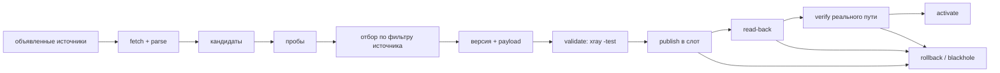

# Upstream pipeline: источники, слоты и версии

Это срез задачи
[#58](https://github.com/juvenileslave/vpn/issues/58) для конфигурации
исходящих апстримов. Реализованы **объявления источников, нормализация
кандидатов, детерминированный отбор, версии/слоты в SQLite, шифрованное
хранение payload и оркестратор с интерфейсами пробера и публикатора**. Реальных
проб через Xray, публикации в панель, проверки живого туннеля и отката на
панели в этом срезе нет: production-реализации `Prober`/`Publisher` не
подключены, CLI `upstream refresh|rollback` и `slot set` отказывают до I/O.
VPN не развёрнут; runtime acceptance отсутствует.

## Модель



Слот 1..63 — фиксированный исходящий путь. Слот 0 — direct exit, для него
upstream-версии запрещены. Каждый цикл создаёт новую версию; в SQLite активна
ровно одна версия на слот. Кандидат, прошедший порог проб и фильтр источника,
становится `upstream`-версией; если healthy-кандидатов нет — активируется
статический `blackhole` для этого слота. Падения на публикации, read-back,
проверке или активации откатывают слот к предыдущей активной версии (или к
`blackhole`, если предыдущей нет). Свободный egress (freedom) не используется
как fallback.

## Объявления источников

Файл объявлений — YAML схемы 1; путь абсолютный, файл `0600`, не symlink, размер
до 256 KiB. От 1 до 64 источников с уникальными `id`; `slot` 1..63; `interval`
от 1m до 24h. Источник включается по умолчанию, `enabled: false` исключает его
из опроса.

```yaml
schema: 1
sources:
  - id: sub-primary
    kind: subscription
    slot: 1
    interval: 6h
    subscription_url: https://provider.example/api/sub/token
    filter:
      countries: [JP, US, DE]
      max_latency: 250ms
      min_successful_probes: 3
  - id: wg-backup
    kind: wireguard_file
    slot: 2
    interval: 12h
    wireguard_path: /etc/vpnctl/upstreams/backup.conf
```

| Поле | Требование |
| --- | --- |
| `id` | строковый идентификатор источника, уникальный в файле |
| `kind` | `subscription` или `wireguard_file` |
| `slot` | целое 1..63 |
| `interval` | Go duration 1m..24h |
| `enabled` | bool, по умолчанию `true` |
| `subscription_url` | только для `subscription`: `https`, без userinfo, до 4096 байт |
| `wireguard_path` | только для `wireguard_file`: абсолютный существующий файл `0600`, не symlink |
| `filter.countries` | до 64 ISO 3166-1 alpha-2 кодов в верхнем регистре |
| `filter.max_latency` | 1ms..60s, `0` — без ограничения |
| `filter.min_successful_probes` | >= 1, по умолчанию 1 |

Локатор (URL подписки или путь WireGuard) не печатается и не сохраняется в
SQLite, Git, логи или сообщения об ошибках. Ошибки валидации перечисляют только
пути полей и причины.

## Нормализация и отбор

- `sharelink` декодирует тело подписки: plain text или base64, по одной ссылке
  в строке; пустые строки и `#`-комментарии пропускаются. Тело ограничено
  1 MiB, число записей — 1024.
- Поддерживаются `vless://`, `trojan://`, `ss://` и один WireGuard-конфиг.
  Каждый кандидат получает outbound-JSON принятого парсера и `tag`
  `upstream-slot-<N>`; неизменяемый ID — SHA-256 канонического outbound-JSON.
  Запись, которую парсер отверг, становится `Reject` без raw-строки и
  credentials.
- `selector` применяет фильтр источника: страна из последней успешной пробы,
  `max_latency` по минимальной успешной задержке и минимум успешных проб.
  Среди подходящих выбирается минимальная успешная задержка; при равенстве —
  лексикографически меньший ID. Порядок входа не влияет на результат.
- Оркестратор выбирает по одному победителю на источник, затем лучшего из них
  по медиане успешных проб (tie-break — ID). Это сохраняет фильтры разных
  источников и делает результат детерминированным.

## Версии, payload и откат

Схема 5 `store` описана в [STATE_STORE.md](STATE_STORE.md):
`upstream_versions` (id, slot, seq, origin, state, payload_ref,
payload_sha256, outbound_fingerprint, failure_code, timestamps) и
`upstream_slots` (mode, active_version_id, failure_count, next_run_at,
last_error_code).

- Outbound-JSON содержит credentials и не пишется в SQLite. Payload лежит в
  отдельном каталоге оператора (`0700`, файлы `0600`) в age-шифре X25519;
  база хранит только ссылку, SHA-256 ciphertext и отпечаток outbound-JSON.
  Без identity чтение завершается ошибкой, plaintext не создаётся.
- Новая версия создаётся в состоянии `candidate`, активация переводит её в
  `active`, предыдущую — в `superseded`. Ошибка переводит `candidate` в
  `failed` с ограниченным кодом (`publish_failed`, `readback_mismatch`,
  `verify_failed`, `activate_failed`, `fetch_failed`, `probe_canceled`,
  `validate_failed`, `payload_put_failed`, `create_version_failed`,
  `active_lookup_failed`, `invalid_outbound`, `internal_error`).
- Read-back сравнивается с опубликованным outbound по SHA-256; расхождение —
  отказ и откат. `Verify` вызывается только для `upstream`-версии: у
  `blackhole` нет туннеля для сквозной проверки.
- `RecordUpstreamFailure` увеличивает счётчик и сохраняет режим слота; слот без
  строки создаётся в `blackhole`. `RollbackUpstreamSlot` возвращает последнюю
  `superseded`-версию с origin `upstream` и никогда не восстанавливает
  blackhole.

## Оркестратор

Пакет `vpnctl/internal/upstream/pipeline` принимает интерфейсы:

```go
type Fetcher interface { Fetch(ctx, src, tag) ([]candidate.Candidate, []candidate.Reject, error) }
type Prober interface { Probe(ctx, cand) ([]selector.Probe, error) }
type Validator interface { Validate(ctx, slot, outbound) error }
type Publisher interface {
    Publish(ctx, slot, versionID, outbound) error
    ReadBack(ctx, slot) (json.RawMessage, error)
    Verify(ctx, slot) error
    Restore(ctx, slot, versionID, outbound) error
}
```

`Pipeline.Refresh` выполняет: fetch включённых источников слота (ошибка одного
источника не отбрасывает кандидатов других; если отказали все — `fetch_failed`)
→ bounded-параллельные пробы (по умолчанию 4, максимум 16) → отбор → запись
payload → `Validate` → создание версии → `Publish` → `ReadBack` → `Verify` →
`Activate`. Любая ошибка после начала публикации вызывает `Restore`
предыдущей версии или blackhole. Single-flight — только внутри процесса и
только на слот (`ErrInProgress`); межпроцессная координация не реализована.

## CLI

| Команда | Результат | Код |
| --- | --- | --- |
| `vpnctl upstream list --sources PATH --store PATH [--format text\|json]` | Слоты, id, kind, interval, enabled, число стран и состояние слота; без локаторов и payload. | 0; 1 — ошибка |
| `vpnctl upstream versions --store PATH --slot N [--limit N] [--format text\|json]` | Версии слота новее первыми: короткий id, seq, state, origin, timestamps. | 0; 1 — ошибка |
| `vpnctl slot show --store PATH [--slot N] [--format text\|json]` | Режим, активная версия, счётчик неудач, next run, последний код ошибки. | 0; 1 — ошибка/слот не найден |
| `vpnctl upstream refresh ...` | Отказ до чтения файлов, БД и сети: публикация не авторизована. | 3 |
| `vpnctl upstream rollback ...` | Отказ до I/O: откат только в локальной БД не является откатом панели. | 3 |
| `vpnctl slot set ...` | Отказ до I/O: публикация не авторизована. | 3 |

Неверные флаги и аргументы — код 2. Мутирующие команды не создают и не
открывают `--store`, пока публикация не разрешена отдельным решением.

## Ограничения

Не реализовано и не проверено в runtime:

- реальный временный Xray-пробер (pinned core, SOCKS/HTTP-проба, внешний IP,
  geo-определение страны) и его очистка;
- production `Validator` с `xray -test` и реальной схемой слота;
- `Publisher` для настоящего пути слота и проверка живого туннеля;
- планировщик (interval/jitter, single-flight между процессами, backoff и
  возобновление), доставка алертов о неудачах;
- сквозной acceptance на одноразовых тестовых системах и реальной панели.

Поэтому `upstream refresh` и `rollback` не подключены: успешный `make
vpnctl-test` доказывает только офлайн-контракты и fail-closed переходы с
fake-реализациями.

## Проверка

```sh
make vpnctl-test   # gofmt, go vet, go test ./...
make check         # публичные файлы, hooks, secret-safe проверки
```

Тесты pipeline используют реальные временные SQLite-базы, age-хранилище и
fake Fetcher/Prober/Validator/Publisher: активация самого быстрого здорового
кандидата, blackhole без healthy-кандидатов, откат при несовпадении read-back,
откат к blackhole при ошибке публикации, single-flight на слот, фильтр страны,
отказ всех источников и отсутствие утечки локатора в ошибках.

## Откат

Откат изменения — revert PR без переписывания `master`; панель, узлы, DNS и
production не менялись. База, обновлённая до схемы 5, не открывается бинарником
старой версии (`ErrUnsupportedSchema`); для даунгрейда нужна копия до
обновления. Секреты и реальные адреса в этом срезе не использовались.
